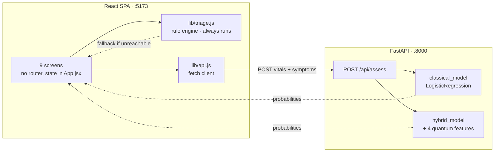
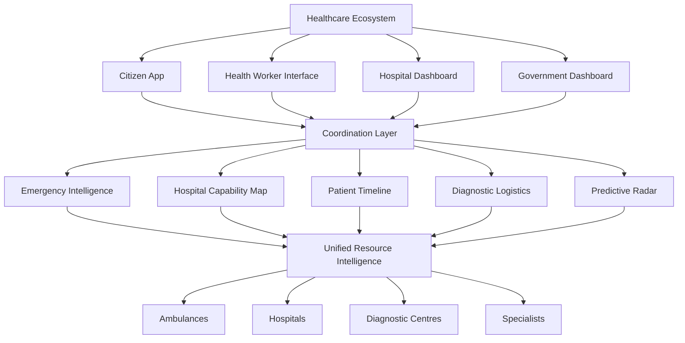

<div align="center">


# JEEVAN-NET

**India's Intelligent Healthcare Response Network**

*From Symptom to Solution — Before It's Too Late.*

[](jeevan-net-phase1)
[](jeevan-net-phase1)
[](Backend)
[](Backend)
[](Backend)
[](docs/limitations.md)

An AI-assisted healthcare **coordination** layer — not another hospital app.

</div>

---

## The idea in one paragraph

Healthcare rarely fails for lack of infrastructure. It fails because the infrastructure is fragmented: the nearest ambulance may lack oxygen, the nearest hospital may lack a CT scanner or a neurologist, and the patient's records are scattered across providers. JEEVAN-NET is a software-first coordination layer that answers four questions in sequence — **what does the patient need, where is that capability, how fast can it be reached, and what happens next** — and then acts on the answer.

> **The core insight:** route the patient to the nearest **suitable** facility, not the nearest facility.

---

## Scope and status

This repository is an honest snapshot. Every row is labelled, because a coordination platform that overstates itself is worse than useless.

| Capability | Status | Where |
| --- | --- | --- |
| Clinical triage (vitals + symptoms → risk) | **Working** | `src/pages/PatientAssessment.jsx` |
| ML scoring API (classical + quantum-derived features) | **Working** | `Backend/main.py` |
| Facility matching with weighted capability scoring | **Working** | `src/lib/scoring.js` |
| Concentric radius lookup, govt vs private | **Working** | `src/pages/FacilityMatching.jsx` |
| GoI NCD screening tables by age and gender | **Working** | `src/data/guidelines.js` |
| Teleconsultation and appointment flow | **Working** | `src/pages/DoctorConsultModule.jsx` |
| Voice symptom intake (13 languages) | **Working** | `src/pages/VoiceCompanionView.jsx` |
| Ambulance dispatch sequence | **Simulated** | `src/pages/Emergency.jsx` |
| Hospital, doctor, and bed data | **Fixture** | `src/data/` |
| ABDM / ABHA integration | **Not implemented** | — |
| Persistence, authentication, multi-user roles | **Not implemented** | — |

`Working` means it runs and produces a result. `Simulated` means the workflow is real but the counterparties are not. `Fixture` means the data is compiled into the bundle. Full detail: [`docs/limitations.md`](docs/limitations.md).

---

## Quick start

Two terminals. The frontend runs on its own — the backend is optional.

**Frontend** (required)

```bash
cd jeevan-net-phase1
npm install
npm run dev          # http://localhost:5173
```

**Backend** (optional, enables the ML verdict)

```bash
cd Backend
python -m venv .venv
.venv\Scripts\activate        # Windows
pip install -r requirements.txt
uvicorn main:app --reload --port 8000
```

With the backend down the triage screen still works, using the local rule engine, and says so on screen:

| Backend | Verdict source | Badge in the result panel |
| --- | --- | --- |
| Running | Trained model | `● Live model` |
| Down or unreachable | Local rule engine | `○ Offline rule estimate` |

Port 5173 is pinned in `vite.config.js` because the backend's CORS allowlist names it only.

**Checks**

```bash
npm run build    # production bundle
npm run check    # static: every cross-module reference resolves
```

There is no test suite yet. `npm run check` verifies imports, not behaviour.

---

## Screens

| | Screen | What it does |
| :-- | --- | --- |
| 🩺 | **Clinical Triage** | Vitals and symptoms in; rule score and ML verdict out, side by side |
| 🏥 | **Concentric Locator** | Facilities ranked inside 1–3, 3–5 and 5–6 km bands, with sector and bed counts |
| 📞 | **Doctor Consult** | Specialist directory, instant video call, appointment booking |
| 🎤 | **Voice Companion** | Spoken symptom intake in 13 Indian languages, with first-aid guidance |
| 📋 | **Age Checklist** | Population-based NCD screening package, by age and gender |
| 💊 | **Expense & Streams** | Allopathy / Ayurveda / Homeopathy allocation and drug cost comparison |
| 🚑 | **Emergency Grid** | Ambulance dispatch status sequence |
| 📁 | **Patient Record** | Demographics and last recorded vitals |

---

## Architecture

### As built



One call crosses the boundary. Everything else — hospitals, doctors, beds, ETAs, guidelines, prices — is fixture data in `src/data/`.

### Designed

The coordination layer this is meant to grow into:



Only the citizen interface and parts of Emergency Intelligence and the Capability Map exist today. See the status table above.

---

## How the scoring works

Three engines, deliberately kept visible rather than merged: [`docs/scoring.md`](docs/scoring.md).

**1 · Rule engine** — `src/lib/triage.js`. Additive, transparent, runs offline. Glucose ≥ 300 scores 3, hypertensive crisis 2, hypoxia 2, each symptom 2, age ≥ 50 scores 1, capped at 15. `HIGH ≥ 9`, `MODERATE ≥ 5`. It also generates the human-readable indicators and recommended action.

**2 · Label heuristic** — `Backend/main.py`. Generates training labels for 3,500 synthetic patients (`risk_score >= 7`, with 2.5% of labels flipped). Uses *different* thresholds from the frontend — symptoms capped at 6 total, age ≥ 65 — which is why the two verdicts can disagree.

**3 · Models** — `StandardScaler` + `LogisticRegression` over the eight vitals, plus a second estimator fed four extra features from a 4-qubit circuit.

### On the "quantum" label

Being precise, because this is where healthcare demos usually overreach: `quantum_features()` builds a **fixed** 4-qubit `RY`/`RZ` + CNOT angle-encoding circuit and evaluates it with a classical `Statevector` simulation. It has **no trainable parameters, no variational loop, and no quantum speedup**. It is a deterministic non-linear feature map — preprocessing, not a quantum model.

What is genuinely novel here is the **coordination layer and the matching logic**, not the classifier.

### Facility matching

`src/lib/scoring.js` weights five attributes:

```
match = 0.30·capability + 0.25·capacity + 0.20·ETA
      + 0.15·specialist + 0.10·diagnostics      → capped at 99
```

Under a `HIGH` risk verdict, facilities with ICU and emergency capability receive a bonus, so a well-equipped hospital outranks a marginally closer one that cannot treat the patient.

---

## The problem

| Challenge | The gap |
| --- | --- |
| Emergency response delays | Hard to identify an ambulance that has the right equipment *and* a hospital that can receive |
| Rural access | Specialists and advanced diagnostics concentrated in cities |
| Specialist shortages | Expertise exists, but is unevenly distributed and poorly routed |
| Diagnostic delays | Patient and centre are not matched on availability, turnaround or cost |
| Fragmented records | History spread across providers, unavailable at the moment of need |
| Ambulance inefficiency | Transport capability is not matched to the receiving facility's readiness |
| Hospital overcrowding | No shared visibility into beds, ICU and patient flow |
| Blood availability | Regional demand and supply gaps surface too late |
| Chronic disease | Worsening trends detected after the fact, not before |
| Public health | Emerging patterns across facilities go unseen |

The central issue is usually **not** the absence of infrastructure. It is the absence of a system coordinating what already exists.

---

## Design principles

| Principle | How it shows up in the code |
| --- | --- |
| **Human-in-the-loop** | AI produces a ranked recommendation; no autonomous diagnosis or prescribing |
| **Transparency over confidence** | Both verdicts displayed side by side, with their source labelled |
| **Graceful degradation** | Backend unreachable → local rule engine, explicitly marked, never silently faked |
| **Privacy-first** | Synthetic data only; no real patient records are present |
| **Interoperability** | Shaped around ABDM/ABHA conventions, though not yet integrated |
| **Offline tolerance** | All clinical logic runs client-side when the network is unavailable |

> AI supports, but never replaces, licensed medical decision-making. Emergency care must never be delayed by cost optimisation. Clinical validation is not claimed, because none has been performed.

---

## Repository layout

```text
Hackathon-Project/
├── README.md                  this file
├── COVEXCODE.md               working notes for the build environment
├── docs/
│   ├── architecture.md        as-built structure, data flow, debt
│   ├── scoring.md             the three engines, compared
│   └── limitations.md         what is not built, and what is not measured
├── Backend/
│   ├── main.py                FastAPI + both models
│   ├── requirements.txt
│   └── README.md
└── jeevan-net-phase1/
    ├── vite.config.js         react plugin, strictPort 5173
    ├── scripts/
    │   ├── verify-imports.mjs static import check  (npm run check)
    │   └── find-dead-css.mjs  lists unreferenced CSS classes
    └── src/
        ├── main.jsx           entry point
        ├── App.jsx            shell, navigation, modal hosting
        ├── Icons.jsx          31 inline SVG icons
        ├── styles.css         all styling
        ├── data/              patients, doctors, facilities, languages, guidelines
        ├── lib/               triage.js, scoring.js, api.js
        ├── components/        Field, Checkbox, RecordItem
        ├── modals/            Auth, VideoCall, AppointmentBooking
        └── pages/             one file per screen, plus Result and FacilityCard
```

---

## Roadmap

| Phase | Scope | Status |
| --- | --- | --- |
| **1 — Core platform** | Emergency intelligence, capability map, patient timeline, diagnostic logistics, predictive radar | Citizen UI + triage + matching built |
| **2 — Network expansion** | Specialist pooling, MED-SHIELD medication safety, MOTHER-GUARD maternal escalation, BLOOD-PULSE forecasting, CARE-COST optimiser | Planned |
| **3 — District intelligence** | Healthcare digital twin, regional demand forecasting, bottleneck detection, inter-facility coordination | Planned |
| **4 — National ecosystem** | Multi-district deployment, broader interoperability, advanced predictive intelligence | Planned |

Longer term, JEEVAN-NET is designed to pair with **RAKSHAK-X**, a disaster-response robotics concept: *disaster → robotic reconnaissance → victim identification → healthcare orchestration → rescue.* RAKSHAK-X supplies victim intelligence; JEEVAN-NET coordinates the medical response.

---

## Documentation

| Document | Contents |
| --- | --- |
| [`docs/architecture.md`](docs/architecture.md) | As-built layout, one-triage data flow, state ownership, structural debt |
| [`docs/scoring.md`](docs/scoring.md) | All three scoring engines side by side, and how to align them |
| [`docs/limitations.md`](docs/limitations.md) | Unbuilt modules, illustrative numbers, security and accessibility gaps |
| [`Backend/README.md`](Backend/README.md) | Endpoints, request schema, what the models actually are |
| [`jeevan-net-phase1/README.md`](jeevan-net-phase1/README.md) | Frontend setup, screen list, project layout |

---

<div align="center">

### We are not building another hospital app.

### We are building the intelligence layer that helps existing healthcare infrastructure work as one system.

*Connecting People. Coordinating Resources. Enabling Timely Care.*

**Research prototype — not a clinical diagnostic system. Do not use for patient care.**

</div>
