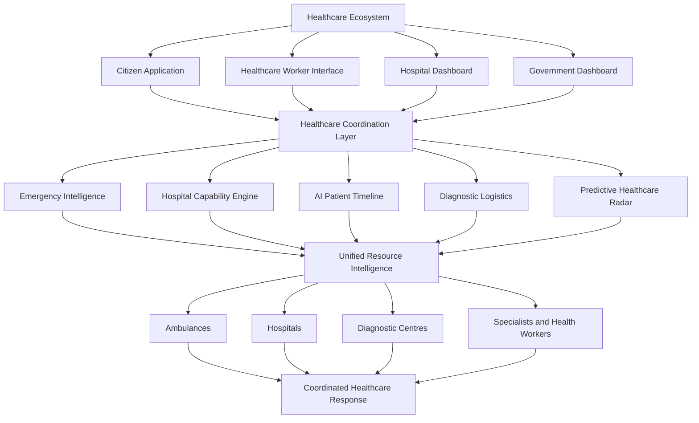

# JEEVAN-NET

### India's Intelligent Healthcare Response Network

**From Symptom to Solution — Before It's Too Late.**

\<p align="center">
&#x20; \<strong>An AI-powered healthcare orchestration platform connecting patients, healthcare workers, ambulances, diagnostic centres, specialists and hospitals through intelligent coordination.\</strong>
\</p>

---

## 1. Overview

Healthcare systems often have the resources needed to save lives, yet patients still experience delays because those resources are fragmented, difficult to locate or poorly coordinated.

A patient may need an ambulance, but not every ambulance has the required equipment. The nearest hospital may not have the necessary specialist, ICU capacity or diagnostic facilities. Medical information may be scattered across multiple providers, making timely decisions difficult.

**JEEVAN-NET** addresses this coordination gap.

It is a software-first, AI-powered healthcare intelligence and orchestration platform designed to connect existing healthcare infrastructure into a coordinated response network.

Rather than functioning as another standalone healthcare application, JEEVAN-NET focuses on answering four critical questions:

- What healthcare assistance does the patient need?
- Where is the required medical capability available?
- How quickly can that capability be reached?
- What should happen next?

Our vision is to help transform healthcare delivery from fragmented and reactive processes into a coordinated, predictive and resource-aware ecosystem.

## 2. The Problem We Are Solving

Healthcare delivery faces several interconnected challenges:

| Challenge                      | Existing Gap                                                             |
| ------------------------------ | ------------------------------------------------------------------------ |
| Emergency response delays      | Difficulty identifying the right ambulance and capable hospital          |
| Rural healthcare accessibility | Limited access to specialists and advanced facilities                    |
| Specialist shortages           | Uneven distribution and utilization of medical expertise                 |
| Diagnostic delays              | Inefficient coordination between patients and diagnostic centres         |
| Fragmented patient records     | Medical information distributed across different providers               |
| Ambulance inefficiency         | Limited coordination between ambulance capability and hospital readiness |
| Hospital overcrowding          | Poor visibility into resource availability and patient flow              |
| Blood availability             | Difficulty anticipating regional demand and supply gaps                  |
| Chronic disease management     | Delayed identification of worsening health trends                        |
| Public-health monitoring       | Difficulty identifying emerging patterns across healthcare facilities    |

The central issue is not always the absence of healthcare infrastructure. It is often the absence of an intelligent system coordinating the infrastructure that already exists.

## 3. Our Solution

JEEVAN-NET introduces an intelligent coordination layer across the healthcare ecosystem.

The platform combines AI-assisted analysis, resource matching, geospatial intelligence, predictive monitoring and human-in-the-loop workflows.

### Core Operating Philosophy

**CONNECT → UNDERSTAND → ACT**

1. **CONNECT:** Connect patients, health workers, doctors, hospitals, ambulances, laboratories and blood banks.
2. **UNDERSTAND:** Evaluate patient needs, urgency, medical history, geographical accessibility and available healthcare resources.
3. **ACT:** Recommend suitable care pathways, coordinate resources, facilitate clinical handoffs and initiate follow-up workflows.

The platform uses specialized intelligence engines instead of depending on one generic chatbot.

## 4. Key Features & Intelligence Modules

### A. Emergency Intelligence

An emergency coordination engine that evaluates the patient's requirements and identifies suitable healthcare destinations.

Key capabilities:

- Emergency severity assessment support.
- Capability-aware hospital matching.
- Ambulance suitability evaluation.
- Travel-time and resource consideration.
- Hospital pre-alert and clinical handoff generation.

**Core innovation:** The system prioritizes the nearest suitable hospital, not simply the nearest hospital.

### B. Hospital Capability Map

A geospatial healthcare resource intelligence layer that represents hospitals and healthcare facilities based on their capabilities.

Potential parameters include:

- Bed and ICU availability.
- Specialist availability.
- CT and other diagnostic facilities.
- Operation theatre availability.
- Blood availability.
- Ambulance and emergency support.

### C. AI Patient Timeline

A consent-based patient information management module that organizes permitted health records into a chronological timeline.

Key capabilities:

- Medical history summarization.
- Diagnosis and medication timelines.
- Identification of relevant health trends.
- Concise clinical briefing generation.
- Structured information handoff between healthcare providers.

### D. Diagnostic Logistics Intelligence

A diagnostic coordination engine designed to identify appropriate diagnostic pathways using:

- Diagnostic availability.
- Geographic distance.
- Expected turnaround time.
- Clinical urgency.
- Estimated cost.

### E. Predictive Healthcare Radar

A predictive intelligence module designed to identify potential healthcare bottlenecks and emerging resource requirements.

Potential applications:

- Blood demand forecasting.
- Hospital resource bottleneck alerts.
- Chronic-care follow-up signals.
- Regional healthcare demand monitoring.
- Public-health anomaly detection.

## 5. System Architecture

JEEVAN-NET follows a modular architecture consisting of specialized intelligence engines connected through a common coordination layer.



### Architectural Principles

- **Modularity:** Independent intelligence engines for different healthcare workflows.
- **Interoperability:** Designed to leverage existing public digital-health infrastructure.
- **Scalability:** Architecture designed to expand from individual facilities to district, state and national deployments.
- **Human-in-the-loop:** AI supports prioritization and coordination while authorized healthcare professionals retain clinical decision-making authority.
- **Privacy-first:** Consent-based access and privacy-preserving information handling.
- **Resilience:** Offline-first workflows with queued synchronization for weak-network environments.

## 6. Core Development Modules

| Module                      | Primary Function                                  |
| --------------------------- | ------------------------------------------------- |
| Emergency Intelligence      | Emergency → triage support → ambulance → hospital |
| Hospital Capability Map     | Healthcare resource and capability matching       |
| AI Patient Timeline         | Consent-based record summarization                |
| Diagnostic Logistics        | Appropriate diagnostic pathway optimization       |
| Predictive Healthcare Radar | Bottleneck, blood and operational alerts          |

The initial implementation prioritizes a demonstrable end-to-end emergency coordination workflow while establishing the foundation for additional healthcare intelligence modules.

## 7. The Emergency Demonstration Scenario

### Case Study: Suspected Stroke Emergency

**Scenario:** A 58-year-old male presents with symptoms indicating a possible stroke.

JEEVAN-NET demonstrates an integrated healthcare coordination workflow.

1. An emergency request is initiated.
2. The emergency risk pathway is activated.
3. Suitable ambulances are evaluated.
4. Stroke-capable hospitals are identified.
5. CT scan availability is checked.
6. Neurologist availability is considered.
7. Travel time and facility capacity are evaluated.
8. A suitable destination is recommended.
9. The receiving hospital is alerted.
10. A structured clinical handoff is generated.
11. A follow-up pathway is created.

### Performance Evaluation

| Evaluation Metric            | Purpose                          |
| ---------------------------- | -------------------------------- |
| Time to appropriate facility | Measures coordination efficiency |
| Unnecessary transfers        | Evaluates referral quality       |
| Resource utilization         | Measures matching efficiency     |
| Handoff completeness         | Evaluates information continuity |
| Response coordination time   | Measures operational performance |

Performance improvements should be calculated from actual test runs and clearly identified as simulated results where applicable.

## 8. User Interfaces

JEEVAN-NET is designed around four primary user environments.

**Citizen Interface**

- Emergency assistance
- My Health
- Find Care
- Medicines
- Medical Reports
- Family
- Follow-up

**Healthcare Worker Interface**

- Patient management
- Emergency requests
- Tele-specialist coordination
- Diagnostics
- Referrals
- Follow-up

**Hospital Dashboard**

- Emergency queue
- Beds and ICU
- Doctor availability
- Ambulance coordination
- Diagnostics
- Blood availability
- Patient flow
- AI-generated operational alerts

**Government Dashboard**

- Population at risk
- Healthcare demand
- Resource availability
- Predicted bottlenecks
- Recommended interventions

## 9. Technology & Implementation Strategy

JEEVAN-NET follows a software-first approach to minimize deployment costs and leverage existing healthcare infrastructure.

The system is designed around the following technical capabilities:

| Technical Area          | Intended Application                                    |
| ----------------------- | ------------------------------------------------------- |
| Artificial Intelligence | Clinical information summarization and decision support |
| Geospatial Intelligence | Facility discovery and location-aware resource matching |
| Optimization Algorithms | Ambulance and hospital resource allocation              |
| Predictive Analytics    | Demand forecasting and operational alerts               |
| Data Management         | Structured patient and healthcare resource information  |
| Interoperability        | Integration with existing healthcare infrastructure     |
| Offline-first Design    | Queued synchronization under weak connectivity          |

The specific frameworks, APIs, databases and deployment infrastructure will be documented as they are implemented and validated.

## 10. Safety, Privacy & Responsible AI

Healthcare technology must be designed with patient safety and accountability at its core.

JEEVAN-NET follows these principles:

- AI supports, but never replaces, licensed medical decision-making.
- Emergency treatment must never be delayed by cost optimization.
- Patient information must be handled through appropriate consent and access controls.
- Synthetic data is used for prototyping unless authorized real-world data access and governance are established.
- Predictions, confidence levels and uncertainty must be clearly communicated.
- Clinical validation must not be claimed without appropriate validation.
- Existing public digital-health infrastructure should be leveraged wherever appropriate.

JEEVAN-NET is designed as a healthcare coordination and decision-support platform, not an autonomous diagnostic or prescribing system.

## 11. Scalability & Future Roadmap

**Phase 1 — Core Platform**

- Emergency Intelligence
- Hospital Capability Map
- AI Patient Timeline
- Diagnostic Logistics
- Predictive Healthcare Radar

**Phase 2 — Healthcare Network Expansion**

- Specialist Pooling Engine
- MED-SHIELD medication safety support
- MOTHER-GUARD maternal and neonatal escalation support
- BLOOD-PULSE demand forecasting
- CARE-COST OPTIMIZER

**Phase 3 — District-Level Healthcare Intelligence**

- Healthcare Digital Twin
- Resource demand forecasting
- Regional bottleneck detection
- Inter-facility coordination
- Public-health intelligence

**Phase 4 — National-Scale Ecosystem**

- Multi-district deployment
- Broader healthcare interoperability
- Advanced predictive intelligence
- Integration with additional healthcare service networks

### Future Extension: RAKSHAK-X

JEEVAN-NET can eventually integrate with RAKSHAK-X, a disaster-response robotics concept.

The proposed workflow:

**Disaster → Robotic Intelligence → Victim Identification → Healthcare Orchestration → Rescue & Medical Response**

RAKSHAK-X can provide aerial or ground reconnaissance and victim intelligence, while JEEVAN-NET coordinates ambulances, blood, diagnostics, specialists and hospitals.

## 12. Repository Structure

The following is the proposed repository organization. It should evolve with the actual implementation.

```text
JEEVAN-NET/
│
├── README.md
│
├── docs/
│   ├── architecture.md
│   ├── system-workflow.md
│   ├── development-roadmap.md
│   └── safety-and-privacy.md
│
├── frontend/
│   ├── citizen/
│   ├── healthcare-worker/
│   ├── hospital-dashboard/
│   └── government-dashboard/
│
├── backend/
│   ├── api/
│   ├── services/
│   └── integrations/
│
├── intelligence/
│   ├── emergency/
│   ├── hospital-capability/
│   ├── patient-timeline/
│   ├── diagnostic-logistics/
│   └── predictive-radar/
│
├── data/
│   ├── synthetic/
│   └── schemas/
│
├── tests/
│   ├── unit/
│   ├── integration/
│   └── simulation/
│
├── assets/
│   ├── screenshots/
│   ├── diagrams/
│   └── logo/
│
├── .gitignore
├── LICENSE
└── CONTRIBUTING.md
```

## 13. Getting Started

The setup instructions will be finalized with the selected implementation stack.

The repository will include:

1. Prerequisites and environment requirements.
2. Installation instructions.
3. Environment variable configuration.
4. Database and synthetic-data initialization.
5. Backend startup instructions.
6. Frontend startup instructions.
7. Instructions for running the emergency simulation.

## 14. Project Impact & Differentiation

**Innovation:** Targets the coordination gap between existing healthcare workflows.

**Technical Depth:** Combines AI, optimization, geospatial reasoning, interoperability and predictive intelligence.

**Feasibility:** The core demonstration can be developed using synthetic healthcare data and simulated hospital and ambulance feeds.

**Scalability:** Designed to expand from a single facility to district, state and national healthcare networks.

**Social Impact:** Aims to improve emergency coordination, utilization of scarce resources and continuity of care.

**Cost Efficiency:** Leverages existing smartphones, hospitals, ambulances, laboratories and public digital-health infrastructure.

## 15. Our Vision

We envision a healthcare ecosystem in which the right medical assistance can be identified, coordinated and reached with greater efficiency.

A system where hospitals are not isolated facilities, ambulances are not independent services, and patient information does not remain fragmented across disconnected workflows.

JEEVAN-NET aims to connect these elements through a unified intelligence and coordination layer.

> **We are not building another hospital app. We are building the intelligence layer that helps India's existing healthcare infrastructure work as one system.**

---

\<p align="center">   \<strong>JEEVAN-NET\</strong>   \<br/>   India's Intelligent Healthcare Response Network   \<br/>\<br/>   \<em>Connecting People. Coordinating Resources. Enabling Timely Care.\</em> \</p>
